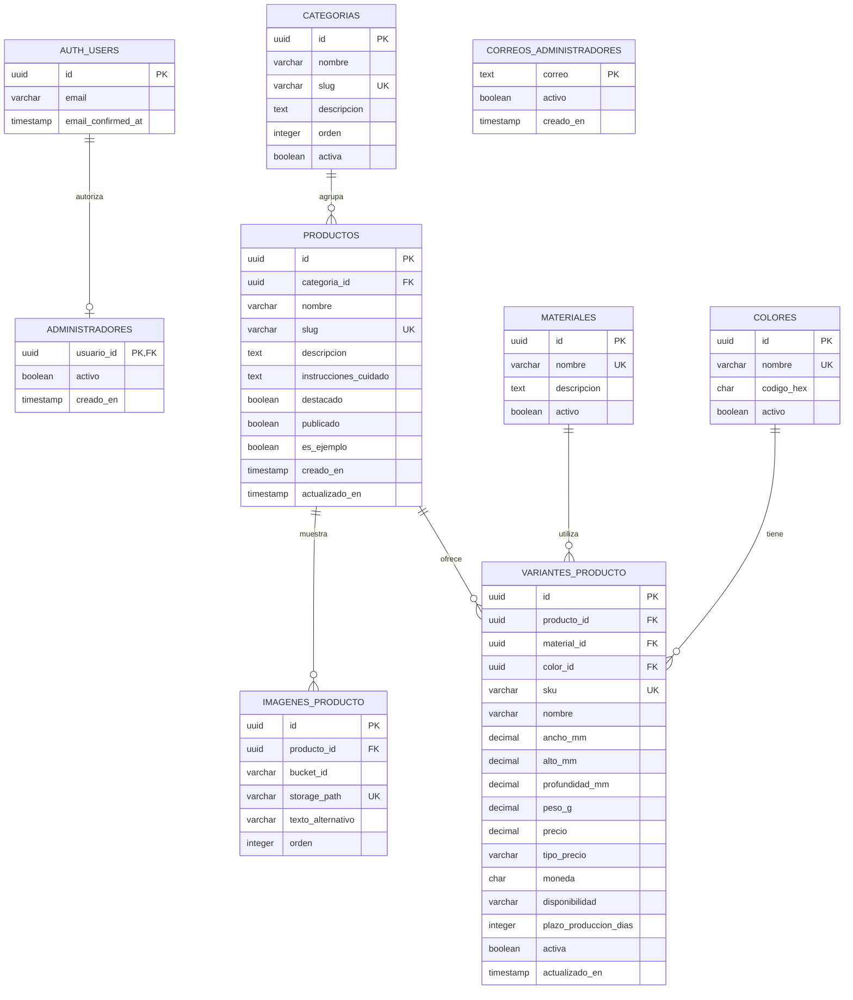

# Base de datos — Catálogo web de impresiones 3D

Modelo del catálogo implementado en Supabase para productos, categorías, materiales, colores, variantes e imágenes. El carrito de cotización se conserva en el navegador; esta base no incluye pedidos ni pagos. La implementación y sus verificaciones están documentadas en [SUPABASE_ETAPA_4.md](./SUPABASE_ETAPA_4.md).

## Diagrama entidad-relación

El siguiente diagrama usa Mermaid y se puede visualizar en un visor Markdown compatible, como GitHub.

**Referencias:** `PK` = clave primaria; `FK` = clave foránea; `UK` = valor único. `||--o{` indica que un registro puede relacionarse con cero o muchos registros de la otra tabla y que cada registro hijo pertenece a exactamente un padre.

## Qué guarda cada tabla

| Tabla | Función | Ejemplo |
|---|---|---|
| `CATEGORIAS` | Agrupa productos por tipo. | Decoración, organizadores, macetas. |
| `PRODUCTOS` | Guarda la información común de cada diseño a la venta. | Maceta geométrica. |
| `IMAGENES_PRODUCTO` | Guarda las direcciones de las fotos y su orden de presentación. | Vista frontal y lateral de una maceta. |
| `VARIANTES_PRODUCTO` | Define cada combinación comercial disponible, con precio y medidas propias. | Maceta mediana, PLA, negro. |
| `MATERIALES` | Describe los materiales de impresión ofrecidos. | PLA, PETG, resina. |
| `COLORES` | Centraliza los colores que se pueden seleccionar. | Negro, blanco, rojo. |

## Reglas de funcionamiento

- Cada producto pertenece a una categoría. Cada variante pertenece a un producto y utiliza un material y un color. Este modelo supone variantes de un solo material y color.
- Un producto puede guardarse como borrador sin fotos ni variantes. Para publicarlo debe tener al menos una imagen y una variante activa; triggers y restricciones diferidas en la base mantienen esta regla incluso después de publicar y al modificar sus imágenes o variantes.
- El precio se define por variante mediante `tipo_precio`: `fijo` o `a_acordar`. Una publicación puede tener todas sus variantes de una modalidad o combinar ambas. Para precio fijo, `precio` y `moneda` son obligatorios; para `a_acordar`, ambos deben ser NULL y se muestra «Acordar con el vendedor».
- `precio` utiliza `NUMERIC(12,2)` no negativo cuando es fijo. No usar cero para representar un precio desconocido. El catálogo calcula «Desde» solo con las variantes de precio fijo y aclara si existen otras opciones a acordar. El carrito no suma precios desconocidos: muestra subtotal conocido y total pendiente de cotización.
- Las medidas se expresan en milímetros y el peso en gramos. Si se informan, deben ser mayores que cero.
- Todos los productos se realizan por pedido. `disponibilidad` admite `bajo_pedido` o `no_disponible`. El plazo es opcional y, si se informa, debe ser un entero no negativo; NULL indica «Plazo a coordinar». No se controlan cantidades por stock. La columna física `stock` se conserva únicamente como dato histórico, sin uso en la interfaz ni en el cálculo del carrito.
- `sku` identifica de forma única cada variante, por ejemplo `MAC-GEO-M-PLA-NEG`. Dos variantes pueden compartir material y color si difieren en tamaño o terminación.
- `slug` permite crear direcciones legibles, por ejemplo `/productos/maceta-geometrica`.
- Las imágenes se almacenan en el bucket privado `productos` de Supabase Storage. La base conserva `bucket_id` y `storage_path` únicos, no URLs firmadas. La foto con menor `orden` se usa como portada y el orden es único dentro de cada producto. Las rutas deben pertenecer al producto y existir en Storage. Los enlaces de lectura vencen en 60 segundos; ver `SUPABASE_ETAPA_5.md`.
- `codigo_hex` es opcional y representa un color orientativo, por ejemplo `#FFFFFF`. No reproduce exactamente la apariencia del material impreso.
- Se recomienda ocultar productos con `publicado = false` y desactivar variantes, materiales o colores en lugar de eliminar información utilizada. Las claves foráneas deben impedir borrar categorías, materiales o colores que tengan registros asociados.
- Las fechas deben guardarse con zona horaria, preferentemente en UTC. `actualizado_en` debe actualizarse desde la aplicación o un trigger.

## Índices y restricciones recomendados

| Tabla | Índice o restricción |
|---|---|
| `CATEGORIAS` | Único en `slug`. |
| `PRODUCTOS` | Único en `slug`; índice en `categoria_id`; índice en `publicado`. |
| `IMAGENES_PRODUCTO` | Único compuesto en `(producto_id, orden)`, que también permite buscar las fotos por producto. |
| `VARIANTES_PRODUCTO` | Único en `sku`; índices en `producto_id`, `material_id` y `color_id`; restricciones de precio, medidas y disponibilidad. |
| `MATERIALES` | Único en `nombre`. |
| `COLORES` | Único en `nombre`; validación del formato de `codigo_hex` cuando esté informado. |

Todas las tablas llevan una clave primaria `id`. Las claves foráneas del diagrama son obligatorias. Los textos descriptivos, el color hexadecimal y los datos físicos pueden ser opcionales. La aplicación debe validar las reglas de publicación y disponibilidad antes de mostrar una oferta al público.

## Ejemplo de uso

Un producto llamado **Maceta geométrica**, dentro de **Decoración**, tiene dos fotos y estas variantes:

| SKU | Variante | Material | Color | Medidas (ancho × alto × profundidad) | Precio ilustrativo | Disponibilidad |
|---|---|---|---|---|---|---|
| MAC-GEO-P-PLA-BLA | Pequeña | PLA | Blanco | 80 × 90 × 80 mm | ARS 5.000 (fijo) | Por pedido: 3 días |
| MAC-GEO-M-PLA-NEG | Mediana | PLA | Negro | 120 × 140 × 120 mm | Acordar con el vendedor | Por pedido: plazo a coordinar |

## Posibles ampliaciones

- **Productos con varias categorías:** agregar una tabla intermedia `PRODUCTOS_CATEGORIAS`.
- **Impresiones multicolor:** reemplazar el color único de la variante por una relación de varios colores por variante.
- **Consultas o presupuestos:** agregar `CONSULTAS` y sus productos asociados si se desea guardar solicitudes recibidas.
- **Tienda online:** incorporar clientes, pedidos, detalles de pedido, pagos y envíos cuando se necesite vender desde el sitio.

Estas ampliaciones no forman parte del diagrama inicial.

## Correspondencia con la implementación

Las seis entidades comerciales usan nombres en minúsculas en `public`. `AUTH_USERS` representa `auth.users`, gestionada por Supabase: el diagrama muestra solo los campos relevantes, no una tabla de contraseñas propia. `ADMINISTRADORES` y `CORREOS_ADMINISTRADORES` están en `private`, sin acceso de lectura o escritura por el navegador. El correo no es clave foránea de Auth: la comprobación de correo confirmado se realiza en la función de autorización y el trigger de alta.

Todas las tablas comerciales tienen `creado_en` y `actualizado_en`, guardados como `timestamptz`; el diagrama mantiene el modelo simplificado. La lista completa de restricciones y columnas es la migración SQL. `es_ejemplo` evita mostrar públicamente el contenido ficticio. Una categoría inactiva oculta también productos, imágenes y variantes. El acceso de los dos administradores está preparado por correo confirmado, pero falta crear sus cuentas reales en Auth.

Actualización de etapa 5: las dos cuentas administrativas ya existen y están confirmadas. Se agregó `public.archivos_pendientes_limpieza` (id UUID, bucket_id, storage_path único, motivo y creado_en) con acceso exclusivo de administradores. No es una galería: registra rutas desvinculadas para eliminarlas por la API de Storage. Sus filas no se borran en cascada con los productos, para no perder el seguimiento del archivo. El bucket no es público; los permisos de sus objetos se relacionan con la visibilidad de la ficha y sus referencias.

## Funciones de la administración (etapa 7)

`public.mi_acceso_admin()` devuelve únicamente si el usuario actual tiene permiso, usando la comprobación privada. `public.reordenar_imagenes(producto_id, ids)` guarda una galería completa de forma atómica. Ambas funciones son SECURITY INVOKER y solo authenticated tiene EXECUTE; ordenar exige además autorización administrativa y respeta RLS. No son entidades nuevas ni almacenan contraseñas. El panel usa fechas de actualización para evitar sobrescribir cambios simultáneos de otros administradores.
