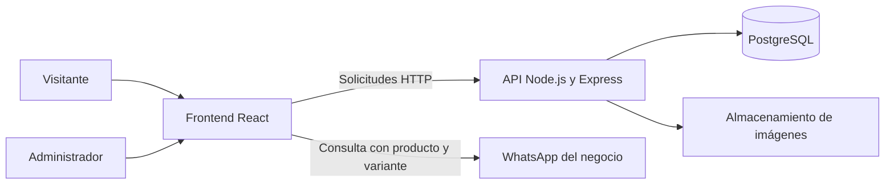

# Proyecto — Catálogo web de impresiones 3D

> **Actualización de arquitectura:** trabajaremos con JavaScript y React, usando Supabase para PostgreSQL, autenticación y almacenamiento de imágenes. Esta decisión reemplaza la propuesta inicial de una API propia con Express y de un proveedor de archivos por definir que aparece más abajo. El plan actualizado está en [TAREAS_DEL_PROYECTO.md](./TAREAS_DEL_PROYECTO.md).

## Objetivo

Crear un catálogo web para mostrar productos impresos en 3D, consultar sus características y conocer las opciones de materiales, colores, tamaños y precios. El visitante podrá elegir una variante y contactar al negocio por WhatsApp para consultar o comprar.

El proyecto se programará en **JavaScript con React**. La primera versión estará enfocada en presentar los productos y facilitar consultas. El carrito, los pagos online y la gestión de envíos quedan como ampliaciones futuras.

## Funciones para los visitantes

- Ver el catálogo de productos publicados.
- Buscar productos por nombre y filtrarlos por categoría.
- Abrir una página con fotos, descripción e instrucciones de cuidado del producto.
- Seleccionar una variante disponible según material, color y tamaño.
- Consultar el precio, las medidas, la disponibilidad y el plazo estimado de producción de la variante seleccionada.
- Enviar una consulta por WhatsApp con el producto y la variante elegidos en el mensaje.
- Navegar desde celulares, tablets y computadoras.

## Administración del catálogo

El negocio necesita un panel privado para mantener el contenido sin editar el código:

- Iniciar y cerrar sesión como administrador.
- Crear y editar categorías, materiales y colores.
- Crear productos, cargar fotos y ordenar su galería.
- Crear variantes con SKU, material, color, medidas, precio y disponibilidad.
- Elegir precio fijo o «Acordar con el vendedor» y actualizar plazos de producción opcionales. Todos los productos se realizan por pedido, sin gestión de stock.
- Publicar u ocultar productos y marcar productos destacados.

Antes de publicar, se debe comprobar que el producto tenga al menos una imagen y una variante activa. Las operaciones del panel deben validarse también en el servidor.

## Tecnologías propuestas

| Parte | Tecnología | Para qué se utiliza |
|---|---|---|
| Interfaz | React con JavaScript | Construir las páginas y componentes del catálogo y del panel. |
| Entorno de desarrollo | Vite | Ejecutar el frontend durante el desarrollo y generar su versión de producción. |
| Navegación | React Router | Organizar las rutas del catálogo, los productos y la administración. |
| Estilos | CSS | Definir la identidad visual y adaptar la interfaz a distintos tamaños de pantalla. |
| Servidor | Node.js con Express | Exponer una API y procesar las operaciones del catálogo y la administración. |
| Base de datos | PostgreSQL | Guardar productos, categorías, variantes, materiales, colores y referencias a imágenes. |
| Archivos | Servicio de almacenamiento de imágenes | Guardar las fotos fuera de la base de datos. El proveedor se define al preparar el despliegue. |

Esta es una propuesta inicial de arquitectura. Las versiones y librerías complementarias se definirán al comenzar la implementación.

## Cómo se conectan las partes



El frontend muestra los datos y permite interactuar con el catálogo. La API consulta la base de datos, valida la información y controla qué acciones puede realizar cada usuario. El acceso directo a la base de datos y las credenciales privadas quedan en el servidor.

## Páginas principales

| Ruta propuesta | Contenido |
|---|---|
| `/` | Presentación del negocio, categorías y productos destacados. |
| `/catalogo` | Lista de productos, búsqueda, filtro por categoría y paginación. |
| `/productos/:slug` | Galería, descripción, selección de variante y botón de consulta. |
| `/contacto` | Información de contacto, redes y condiciones generales de producción. |
| `/admin/login` | Acceso del administrador. |
| `/admin` | Panel para mantener productos, variantes y datos del catálogo. |

También se necesitan estados de carga, mensajes de error, avisos cuando no hay resultados y una página para direcciones inexistentes.

## Datos del proyecto

La estructura inicial está definida en [DIAGRAMA_BASE_DE_DATOS.md](./DIAGRAMA_BASE_DE_DATOS.md).

Las entidades principales son:

- **Categorías:** organizan el catálogo.
- **Productos:** contienen la información común de cada diseño.
- **Imágenes:** forman la galería de cada producto.
- **Variantes:** representan las opciones que se ofrecen, con sus precios y disponibilidad.
- **Materiales y colores:** definen las opciones utilizadas por las variantes.

Para incorporar el panel privado será necesario agregar un mecanismo de autenticación y autorización de administradores, con su almacenamiento de cuentas y sesiones. Esa parte todavía no está incluida en el diagrama inicial.

## Organización sugerida del código

```text
catalogo-3d/
├── frontend/
│   ├── public/
│   └── src/
│       ├── components/    # Componentes compartidos
│       ├── pages/         # Páginas públicas
│       ├── admin/         # Pantallas de administración
│       ├── services/      # Comunicación con la API
│       ├── hooks/         # Lógica reutilizable de React
│       ├── styles/        # Estilos de la aplicación
│       └── main.jsx
├── backend/
│   └── src/
│       ├── routes/        # Rutas de la API
│       ├── controllers/   # Procesamiento de solicitudes
│       ├── services/      # Reglas del negocio
│       ├── middleware/    # Sesiones, permisos y validaciones
│       ├── db/            # Conexión y migraciones
│       └── app.js
└── README.md
```

Esta estructura es orientativa y se puede simplificar según el tamaño real del proyecto.

## Información que debe preparar el negocio

- Nombre, logo, colores y una breve presentación de la marca.
- Número de WhatsApp y enlaces a redes sociales.
- Categorías y lista inicial de productos.
- Fotos claras, descripciones y recomendaciones de cuidado.
- Materiales, colores, tamaños y precios de las variantes.
- Disponibilidad y plazos habituales para trabajos bajo pedido.
- Condiciones de retiro o entrega y zona de atención.
- Dominio y presupuesto disponible para alojamiento y almacenamiento.

## Requisitos de calidad

- **Diseño adaptable:** uso cómodo desde el celular y controles fáciles de tocar.
- **Accesibilidad:** formularios con etiquetas, navegación con teclado, contraste legible y textos alternativos en imágenes.
- **Rendimiento:** imágenes optimizadas, carga diferida de galerías y catálogo paginado.
- **Seguridad:** permisos de administrador comprobados en el servidor, contraseñas protegidas con hash, validación de entradas y cargas de imágenes, consultas parametrizadas y secretos fuera del código.
- **Mantenimiento:** configuración por variables de entorno, migraciones de base de datos y copias de seguridad.
- **Visibilidad en buscadores:** direcciones legibles, títulos y descripciones por producto. Antes de implementar, definir si se necesita prerenderizado para mejorar la indexación y las vistas previas al compartir enlaces.

## Etapas de desarrollo

1. **Definición y contenido:** confirmar la identidad visual, reunir los primeros productos y cerrar las reglas de precios y disponibilidad.
2. **Interfaz pública:** construir con React el catálogo, el detalle del producto y la consulta por WhatsApp usando datos de ejemplo.
3. **Base de datos y API:** implementar el modelo, sus validaciones y la lectura de productos publicados.
4. **Administración:** incorporar autenticación, permisos, edición de productos, variantes y carga de imágenes.
5. **Integración y verificación:** conectar las partes y comprobar los recorridos principales, los permisos y el uso desde celular.
6. **Publicación:** configurar alojamiento, dominio, HTTPS, variables de entorno y copias de seguridad.

## Criterios para completar la primera versión

- El visitante puede encontrar un producto, elegir una variante y abrir WhatsApp con los datos correctos.
- Los productos ocultos y las variantes inactivas no se ofrecen en el catálogo público.
- Los precios y la disponibilidad coinciden con la variante seleccionada.
- El administrador puede actualizar el catálogo y las fotos sin modificar código.
- Un usuario sin autorización no puede realizar operaciones administrativas, incluso llamando directamente a la API.
- Las páginas funcionan en celular y muestran mensajes comprensibles cuando faltan datos o falla una solicitud.
- La aplicación queda publicada con una copia de seguridad de la base de datos y una guía básica para mantenerla.

## Ampliaciones futuras

Carrito de compras, pagos online, pedidos, envíos, cuentas de clientes, favoritos y solicitudes de impresión personalizada con archivos 3D. Cada ampliación requiere definir sus reglas y extender la base de datos antes de implementarla.


## Regla comercial actualizada — 2026-11-04

La producción es por pedido, sin stock. Se ofrecen publicaciones con precio fijo y otras con la leyenda «Acordar con el vendedor», especialmente cuando el tamaño requiere cotización. La modalidad se configura por variante, permitiendo que una publicación reúna ambas. Los importes desconocidos no se muestran como cero ni se suman al total: el carrito informa el subtotal conocido y el total final pendiente de cotización. El plazo puede quedar a coordinar.
